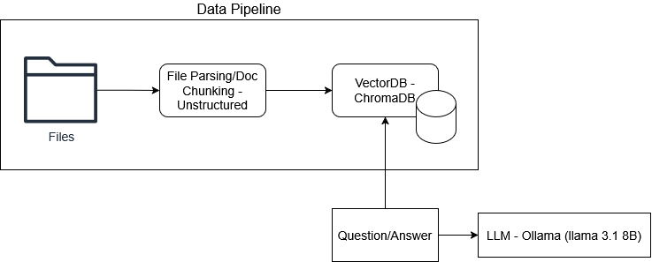

# Architecture Overview

The architecture follows a simple yet modular design approach. This approach makes the system easy to understand and modify to meet future needs. There is a data piple with two parts; File parsing alow with data chubking and vector db with ebmeedings. The system has an LLM interface that pulls context from the vector database based on the question and sends the question along with the context. The LLM forms an answer and provides a JSON document with the question, answer, and source documents.
# Implementation Details

The file parsing and chunking are accomplished with the unstructured Python library. I chose this library because it handled two pipeline steps in a single call and supported several file formats, including PDF, TXT, and HTML. The vector database is ChromaDB; when a document is added, it generates embeddings using the all-MiniLM-L6-v2 model via ONNX/Sentence-Transformers. You can upgrade the embedding to an OpenAI embedding to improve quality. However, this wasn't done because it wasn't local or free. The semantic search runs within the vector database using Euclidean distance. ChromaDB was selected because it is a simple, embedded setup that uses local resources. The LLM is a local Ollama instance; it has no cost and can be swapped for the OpenAI LLM API. The LLM model is Llama 3.1 8 B. 

# Code Usage
You can run the included notebook in Google Colab using the Run All command. However, the code details are below, so you can use it in other environments.  

## Considerations
The current code parameters are hardcoded and can be moved into a YAML file for easier maintenance and editing. The data pipeline runs on each execution, so the vector DB is rebuilt each time; this is done in Google Colab because instances delete data on disconnect. However, it should be set up to do so via a switch variable or auto-detected. 
# Example Usage
Developed and ran the notebook in Google Colab. The Google Colab compute instance was an A100. The instance type supports the local LLM used.

## Reference Data
The papers are located in the ./files directory of this repo. 
- Crisp, Nicholas & Smith, Katharine & Hollingsworth, Peter. (2014). Small Satellite Launch to LEO: A Review of Current and Future Launch Systems. TRANSACTIONS OF THE JAPAN SOCIETY FOR AERONAUTICAL AND SPACE SCIENCES, AEROSPACE TECHNOLOGY JAPAN. 12. Tf_39-Tf_47. 10.2322/tastj.12.Tf_39. 
- González-González, Rubén, García Pérez, Andrés Y Alonso, G. (2022). Small Satellites Launcher Design Efficiency Improvement through the Application of Multidisciplinary Modeling and Simulation-Based Systems Engineering.
- Adilov, Nodir & Albertson, Nikolas & Alexander, Peter & Cunningham, Brendan. (2021). An Economic Analysis of Launch Cost Reductions for Low Earth Orbit Satellites.
- Maklisuwan, Settapong & Kanchanarat, Borwonrat. (2022). Small Satellites for Low-Cost Space Access: Launch, Deployment, Integration, and In-Space Logistics. American Journal of Industrial and Business Management. 12. 1480-1497. 10.4236/ajibm.2022.1210082. 
- Savvina, Elena & Panasenkov, Valery. (2017). Affordable Small Satellites Launch Options Research.
- Wertz, J., Conger, R., Rufer, M., Sarzi-Amadé, N., & Van Allen, R. (2011). Methods for achieving dramatic reductions in space mission cost. https://s3vi.ndc.nasa.gov/ssri-kb/static/resources/Cost-Reduction-paper.pdf

## Example Questions

## Example Output

# Acknowledgment of AI Usage

AI was used for documentation formatting and grammar checking via Grammarly. Google AI was used to research which libraries are available to use for each component of the system. It was also used to understand library code usage, provide example code, and provide a basic framework. Google AI helped troubleshoot code implementation issues, including error messages and proposed code fixes. 
